# Phase 4 train 탐색 분석 — R&E 개별 자료

## 분석 대상과 제외

train 3,000개 시나리오, 126,000개 후보. 시작·도착·로봇·장애물이 같은
42개 후보는 서로 독립적인 표본이 아니다. 머신러닝 학습·가중치 조정·추천기·
최종 포스터는 이번 산출물에 포함하지 않는다. validation/test/challenge 결과는
탐색에 사용하지 않았다. 입력 버전은 `phase4-mathematics-v2`다.

| stage | included | excluded | reason |
| --- | --- | --- | --- |
| composition | 3000 | 0 | all train scenarios |
| winner/relationship | 2147 | 853 | no selection_valid candidate; see scenario_exclusions.csv |

유효 후보가 없는 시나리오도 구성·유효성의 분모에는 남긴다. 목적별 승자와
관계 그림에서는 유효 후보가 있는 2,147개 시나리오만 포함한다.

## 1. 구성과 유효성

| curve_name | variants_per_scenario | candidates | reachable | valid | scenarios_any_valid | scenario_valid_rate |
| --- | --- | --- | --- | --- | --- | --- |
| 원호 | 8 | 24000 | 18824 | 5696 | 1903 | 0.63433 |
| 베지어 | 8 | 24000 | 18340 | 5122 | 1659 | 0.553 |
| 사이클로이드 | 8 | 24000 | 18804 | 5955 | 2008 | 0.66933 |
| 에르미트 | 8 | 24000 | 17988 | 4818 | 1454 | 0.48467 |
| 리마송 | 8 | 24000 | 4240 | 1777 | 667 | 0.22233 |
| 직선 | 2 | 6000 | 4228 | 1341 | 889 | 0.29633 |

변형과 팔꿈치 해를 합쳐 직선 2개, 나머지 종류 각각 8개다. 변형이 많은 종류는
하나 이상의 유효 후보 및 목적별 최소값을 확보할 탐색 기회가 더 많다.
원자료에서 유효 후보 확보율이 가장 큰 종류는 사이클로이드이며
2,008/3,000 (66.9%)다.
이는 **이 생성 분포·준비된 후보군·161표본 검사**에서의 관찰이지
모든 환경에서 해당 곡선이 우월하다는 결론이 아니다.
도달률/도달가능 중 무충돌률/전체 유효률은 분모가 서로 다르다. validity.csv 참조.

## 2. 유효 후보 없음의 원인

| reason | scenarios |
| --- | --- |
| has_valid | 2147 |
| all_unreachable | 0 |
| all_reachable_colliding | 32 |
| mixed_unreachable_collision | 821 |
| other_calculation_or_schema | 0 |

all_unreachable: 42개 모두 도달 실패. all_reachable_colliding: 모두 도달하지만 충돌.
mixed_unreachable_collision: 도달 실패 후보와 도달 가능한 충돌 후보가 함께 있음.
other_calculation_or_schema: 이들로 설명되지 않는 경우. 분류는 배타적이지만
도달 불가가 선행되면 장애물 충돌이 가려질 수 있다. 후보군에 해가 없음은
**환경 자체에 경로가 존재하지 않는다는 증명과 다르다**. 후보군/회피 전략 보강이 필요하다.

## 3. 목적별 승자 — 참고 통계와 검증 사례 분리

winner_shares.csv의 세 scope:

- original_161_reference_only: 전체 유효 train 시나리오의 기존 값 기술통계.
- obstacles_only_reference: 장애물이 있는 시나리오만 같은 방식으로 재집계.
- verified_cases_only: 사전 수치 기준을 목적별로 통과한 일부 사례만 집계.

3번 그림은 첫 범위의 **수치 미확정 참고 결과**다. 저크 및 종합을 포함하여
검증되지 않은 전체 자료에서 확정적 우열을 결론내리지 않는다. 결정적 승자는
원 목적값, L, curve_key, shape, elbow_mode, run_id 순으로 정렬한다.
동점은 math.isclose 상대·절대 1e-12이고 분수 집계는 동점 후보 각각 1/k다.
후보별 분수 배분도 변형 수의 차이에 영향받는다.
무장애물에서는 O=0 동점이므로 결정적 safety 승자를 안전 우월로 해석하지 않는다.

| objective | cases | verified | same_winner | same_tie_set |
| --- | --- | --- | --- | --- |
| balanced | 19 | 14 | 19 | 19 |
| curvature | 19 | 15 | 19 | 19 |
| distance | 19 | 15 | 19 | 19 |
| jerk | 19 | 14 | 19 | 19 |
| joint_effort | 19 | 15 | 19 | 19 |
| safety | 19 | 15 | 19 | 19 |

verified 열은 목적별 검증 시나리오 수다. 선정 규칙상 극단 사례가 포함되어 있으므로
이 작은 집합의 승자 비율도 전체 환경 모집단의 비율로 해석하지 않는다.

## 4. 지표의 관계와 대응 비교

관계 그림은 각 시나리오의 유효 후보 중 고정 해시 순서로 하나를 선택하여
점 하나=시나리오 하나로 만들었다. 값에 유리하게 대표를 고른 것이 아니다.
원 지표와 normalized_*은 다른 열이다. 본 그림은 원 지표다.

| x | y | independent_scenarios | spearman_rho |
| --- | --- | --- | --- |
| path_length_units | joint_velocity_effort | 2147 | 0.82865 |
| joint_jerk_effort | regularized_curvature_energy_inv_unit | 2147 | 0.20414 |
| min_obstacle_clearance_units | obstacle_penalty_s_per_unit2 | 1735 | -0.9625 |

이 값은 원 지표 순위 사이의 Spearman 기술통계다. p값·유의성 결론은 산출하지 않았다.
L–Eθ의 양의 연관, 여유–벌점의 음의 연관은 이 표본에서 관찰된 관계이며,
시간·로봇 크기·경로 형태와 후보 선택 과정의 영향을 제거한 인과효과가 아니다.
J–Kε 관계는 수치 미확정 J를 포함하는 참고값으로 한정한다.

길이 unit, Eθ rad²/s, A rad²/s³, J rad²/s⁵, Kε 1/unit, O s/unit².
Eθ는 줄(J) 단위의 실제 에너지가 아니다. 곡률과 각저크도 다른 개념이다.

본 원자료 이동시간은 [3.0]초다. 같은 공간 경로의
시간을 늘리면 Eθ∝T⁻¹, A∝T⁻³, J∝T⁻⁵, O∝T인 차이가 생긴다.
L과 Kε는 시간과 무관하다. 로봇·환경을 같은 비율 a로 확대하면 보통 L∝a,
Kε∝a⁻¹이나, O는 고정 링크 반지름·clearance epsilon 때문에 단순 축척 법칙이
그대로 성립하지 않을 수 있다. 원 지표의 시나리오 간 크기 차이를 곡선 효과만으로
해석하지 않는다. normalized_*은 같은 시나리오의 유효 후보 범위에 상대적이다.

paired_objective_comparisons.csv는 **각 목적별** family 최소값을 대표로 골라,
같은 시나리오에서 두 종류 모두 유효할 때만 대응 비교했다. 차이는 A−B의
원 지표 차이며 음수는 family_a가 작다는 뜻이다. 한 목적의 최소 후보를 다른
목적에서도 공정한 대표로 간주하지 않는다. 표본 수는 paired_scenarios다.
수치 미확정 참고표로 유지했으며 유의성 검정이나 독립 후보 가정의 CI를 쓰지 않았다.

## 5. 조건별 비교

conditional_validity.csv에 장애물 배치/수, 링크 비율, 이동거리/총길이,
각도차, 시작·도착 반경/총길이별 후보 확보율을 저장했다.
구간은 사전 계획의 고정 경계이며 왼쪽 포함·오른쪽 제외다.
ratio는 <0.75, [0.75,1.3333333333), 그 이상;
여기서는 link1/link2를 새로 계산했다. 원자료 link_ratio=짧은 링크/긴 링크와 다르다.
motion은 [0,.5), [.5,1), [1,2.01); 반경은 [0,.4), [.4,.8), [.8,1.01);
각도차는 [0,60), [60,120), [120,181)이다.
n<30은 small_n=true. 빈 구간은 관측이 없으며 성능 0으로 채우지 않는다.
같은 조건 안에서도 다른 기하 요소가 함께 달라져 인과효과가 아니다.

## 6. 사례와 보고서에 쓸 수식

representative_equations.json에 scenario_id/run_id, 실제 입력, x(u),y(u),
x(t),y(t), 역기구학 합성식, 적분값을 보존했다. 긴 수식은 Excel에 잘라 넣지 않는다.
q(t)=10(t/T)³−15(t/T)⁴+6(t/T)⁵, p(t)=p(q(t)).
X=x(t)−bx, Y=y(t)−by, c₂=(X²+Y²−L₁²−L₂²)/(2L₁L₂).
θ₂=±acos(c₂), θ₁=atan2(Y,X)−atan2(L₂sinθ₂,L₁+L₂cosθ₂).
주값 계산 후 시간 표본은 2π 배수로 unwrap한다.

L=∫₀¹√(x′²+y′²)du; Eθ=∫₀ᵀ(θ̇₁²+θ̇₂²)dt;
A=∫₀ᵀ(θ̈₁²+θ̈₂²)dt; J=∫₀ᵀ(θ⃛₁²+θ⃛₂²)dt;
Kε=∫₀¹(x′y″−y′x″)²/(x′²+y′²+ε²)^(5/2)du;
O=∫₀ᵀ1/max(c(t),εc)²dt (무장애물은 0).
종합 C=100(.25nL+.20nE+.20nJ+.20nK+.15nO), 보상 R=100−C.
모든 원 비용은 작을수록 좋다. A는 종합에 들어가지 않는다.

## 그래프별 한글 캡션

### 01_composition

train 3,000개 시나리오의 로봇 크기·비율·장애물 수 분포. 후보 행을 독립 표본으로 세지 않았다.

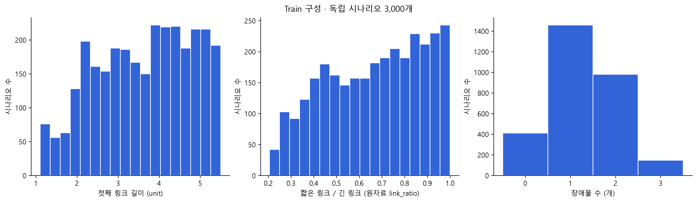

### 02_validity

왼쪽은 후보 단위 비율(직선 6,000개, 다른 종류 각각 24,000개); 오른쪽은 각 종류에 유효 후보가 하나 이상 있는 시나리오 비율. 조건부 무충돌률의 정확한 분모는 validity.csv의 reachable 열이다. 표본 검사이며 연속 안전 보증이 아니다.

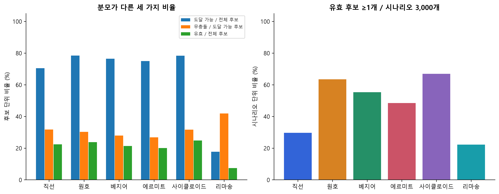

### 03_winners_reference

유효 후보가 있는 train 시나리오만 분모로 한 기존 161표본 승자 집계. 연한 빗금은 동점 후보 각각 1/k씩 배분한 합계다. 직선은 후보 2개, 나머지는 8개다. safety의 무장애물 동점은 안전 우월을 뜻하지 않는다. 검증된 일부 사례 집계는 winner_shares.csv의 verified_cases_only로 분리했다.

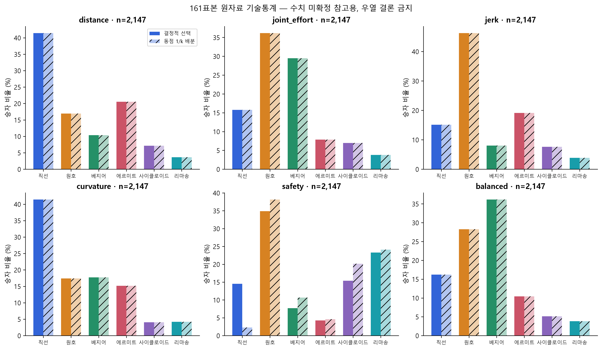

### 04_relationships

각 시나리오에서 목적값과 독립적인 고정 해시로 유효 후보 1개를 골랐다. 독립 시나리오 하나가 점 하나다. 세로축은 symlog(선형 경계 0.01); J 가로축도 같다. 상관의 인과적 해석이나 수치 미확정 지표의 우열 주장은 하지 않는다.

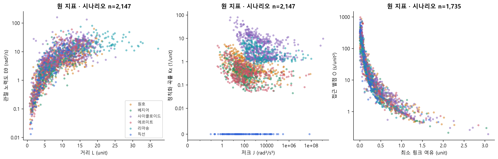

### 05_conditions

장애물 배치별로 동일 train 시나리오 집합에서 곡선 종류의 후보 확보율을 비교했다. 행별 n이 분모이며 환경 자체의 경로 존재율은 아니다.

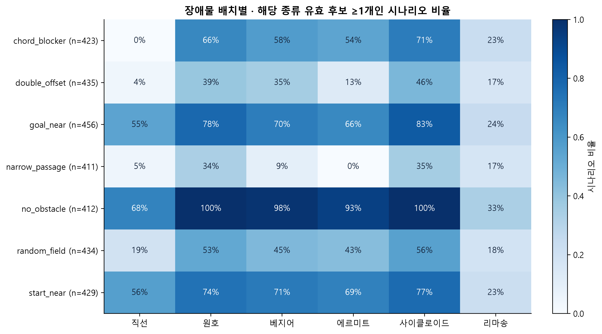

### 10_geometry_conditions

사전 고정 구간별로 해당 종류의 유효 후보가 하나 이상 있는 상황 비율. 같은 구간의 모든 종류는 동일 상황 수를 분모로 쓴다. 경계는 왼쪽 포함·오른쪽 제외, n<30은 CSV에 소표본 표시. 인과적 곡선 효과나 전체 환경 성능으로 해석하지 않는다.

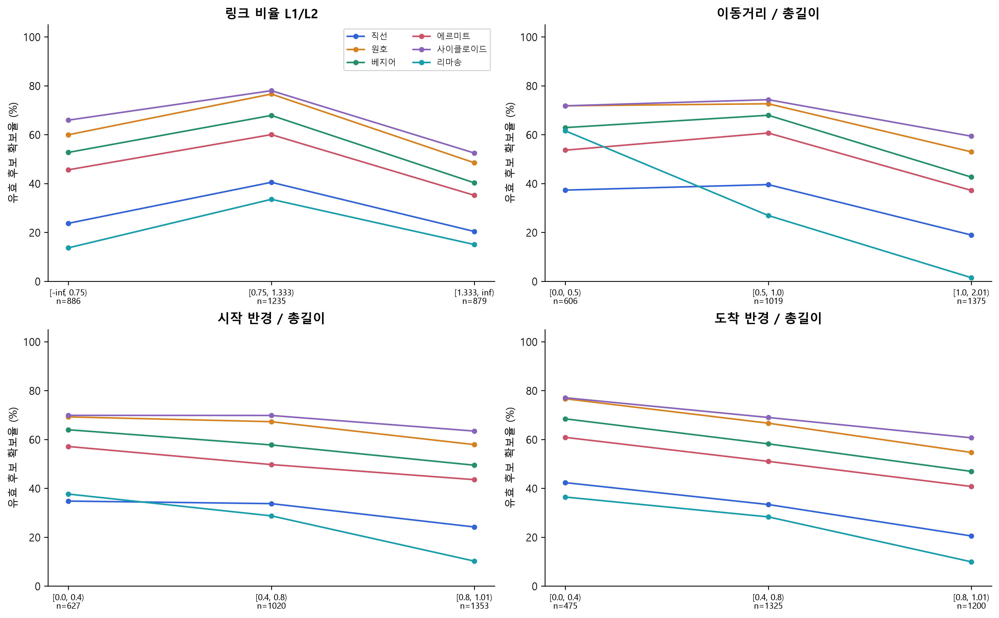

### 06_convergence

선정된 train 시나리오의 전 후보를 재계산했다. 세로축은 |N−641|/(atol+rtol·|641|), 빨간 선 이하는 사전 허용범위다. 641은 참값이 아니다. 목적별 161·321 두 비교와 유효성 변화를 함께 판정했다.

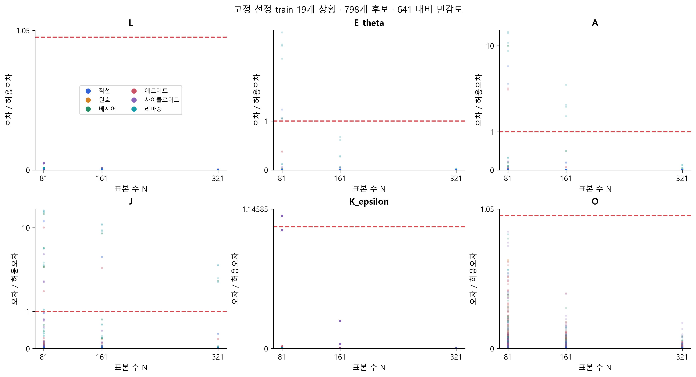

### 07_verified_example

수치 기준을 여섯 목적 모두 통과한 train 실행. scenario_id=P4S001541, run_id=P4S001541_line_up. 정확한 곡선식·IK 합성식은 representative_equations.json 참조. 결측은 그려지지 않으며 0이 아니다.

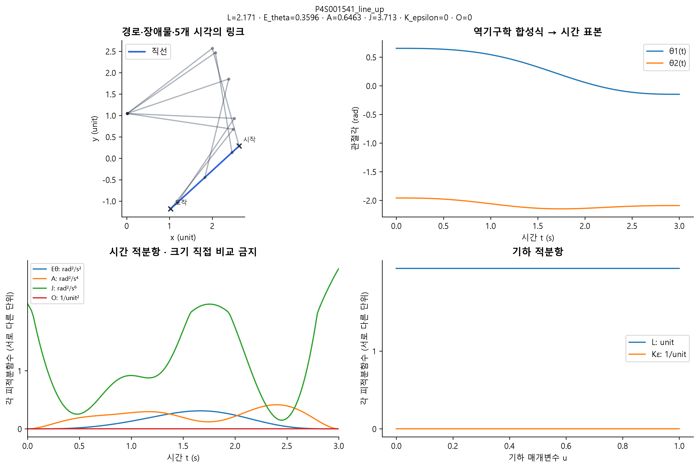

### 08_unreachable

unreachable 사전 선정 실패 사례. scenario_id=P4S001084, run_id=P4S001084_hermite_m40_up. 정확한 곡선식·IK 합성식은 representative_equations.json 참조. 결측은 그려지지 않으며 0이 아니다.

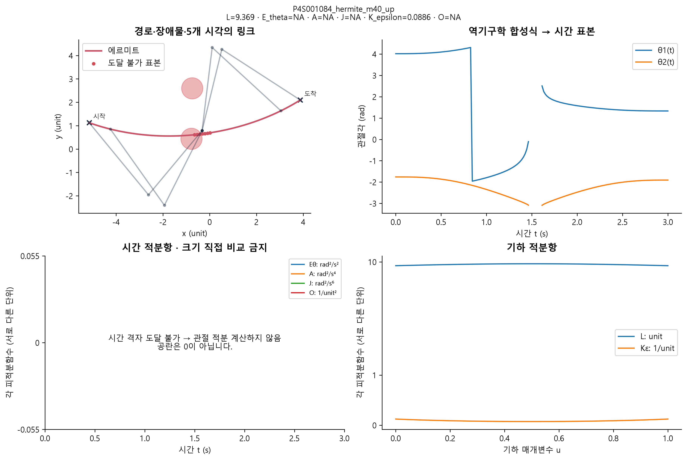

### 08_reachable_collision

reachable_collision 사전 선정 실패 사례. scenario_id=P4S000887, run_id=P4S000887_line_down. 정확한 곡선식·IK 합성식은 representative_equations.json 참조. 결측은 그려지지 않으며 0이 아니다.

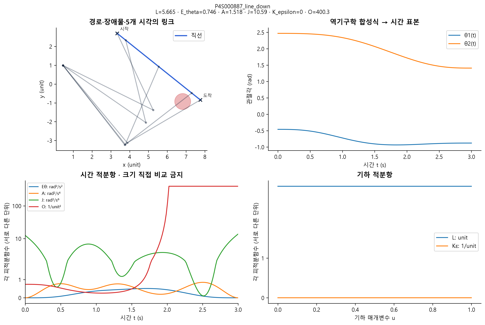

### 09_objective_tradeoff

동일 시나리오에서 수렴성 기준을 통과한 목적들이 실제로 다른 후보를 선택한 사례. 팔꿈치 해만 다른 후보는 끝점 경로가 겹칠 수 있다. ID·수식은 tradeoff_equations.json 참조.

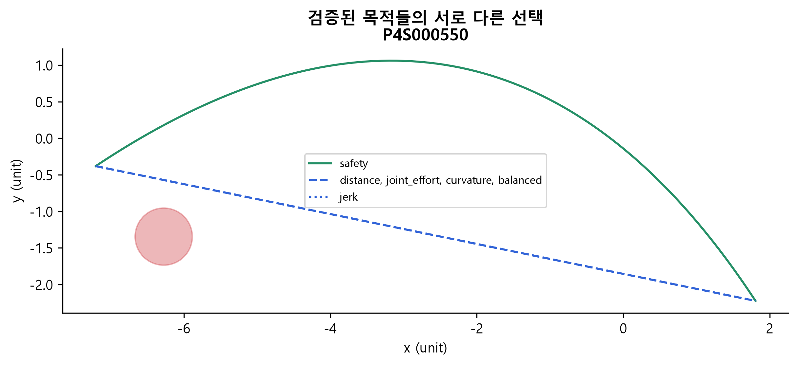

## 재현과 향후 모델 학습 전 보완

```powershell
py -m pip install -e ".[data,analysis]"
py scripts/audit_phase4.py --stage all
py scripts/report_phase4.py
node scripts/build_phase4_workbook.mjs
py scripts/verify_phase4_outputs.py
```

Excel 빌더는 @oai/artifact-tool이 있는 Node 환경이 필요하다. 기존 GUI·이전 포스터·
원자료는 보존한다. 모든 표의 기계 판독 원본은 이 폴더 CSV, 수치 검증은
../phase4_quality/quality_report.md다. 그림은 300dpi PNG와 SVG다.

1. 불안정 지표의 독립 미분/적분·더 높은 해상도 검증을 먼저 수행한다.
2. 연속 충돌 검사와 no_valid_candidate의 회피 후보군 보강을 검토한다.
3. 바뀐 평가값/라벨은 새 데이터 버전에 기록하고 구버전과 혼합하지 않는다.
4. 모델 특징은 입력 기하만 사용한다. 평가값·승자·정규화·도달/충돌 결과의 누출을 차단한다.
5. scenario_id 분할을 유지하고 validation은 다음 단계 모델 선택에만, test는 최종 평가에만 쓴다.
6. 여러 생성 시드·새 장애물 배치로 일반화를 확인한다. 데이터가 많다는 이유만으로
   과적합 해결을 주장하지 않는다. 모든 최적은 현재 준비된 42개 후보 안에서다.
