# Phase 4 v3 train 분석 결과

## 핵심 결과

새 데이터 버전 `phase4-mathematics-v3`의 train **3,000개 시나리오, 126,000개 후보**를 분석했다.
구성·유효성에는 전체 3,000개 상황을 사용했다. 주 승자·대응 비교·관계 분석에는 **2,136개 상황**을 사용했다.
미확정 대안이 있는 12개 상황과, 미확정은 없지만 유효 후보가 없는 852개 상황을 주 비교에서 제외했다.
이 둘은 서로 겹치지 않는다. 후보 단위 미확정은 16개다. 제외된 상황에서의 곡선 성능을 이 결과로 대신 설명하지 않는다.

각 곡선 종류에 유효 후보가 하나 이상 있는 상황 비율이 가장 큰 종류는 **사이클로이드**이다.
2,006/3,000 = 66.9%였다. 이는 생성된 환경 분포·주어진 변형 범위에서의 후보 확보율이다.
모든 환경에서 그 곡선이 더 좋다는 결론이 아니다.

| 목적 | 결정적_최다 | 결정적_비율 | 동점배분_최다 | 동점배분_비율 | 동점_상황 |
|---|---|---|---|---|---|
| 거리 L | 직선 | 0.412453 | 직선 | 0.412453 | 826 |
| 관절 노력도 Eθ | 원호 | 0.362828 | 원호 | 0.362828 | 0 |
| 각저크 J | 원호 | 0.463483 | 원호 | 0.463483 | 0 |
| 정칙화 곡률 Kε | 직선 | 0.412453 | 직선 | 0.412453 | 830 |
| 접근 벌점 O | 원호 | 0.348315 | 원호 | 0.380889 | 420 |
| 종합 비용 | 베지어 | 0.360955 | 베지어 | 0.360955 | 0 |

위 표는 0–1 비율이다. 승자는 준비된 **42개 후보 안에서**의 계산 결과다.
결정적 집계는 원값 차이가 극히 작아도 정렬 순서에 민감할 수 있다. 동점 배분도 수치 오차를 반영한 확률이 아니다.
목적별 수치 허용오차보다 작은 후보 간 차이의 순위까지 검증한 결과로 해석하지 않는다.

## 1. 분석 범위와 재현성

- 사전 규칙: `docs/phase4_v3_analysis_protocol.md`. 사례/관계 선택 시드 20260913.
- 완료된 train receipt가 가리키는 파일만 읽었다. validation/test/challenge 결과를 열거나 분석하지 않았다.
- 동일 scenario_id의 42개 후보는 같은 조건의 대응 자료다. 후보 126,000개를 독립 표본 126,000개라고 하지 않는다.
- ML 학습, 가중치 조정, 추천 기능, 최종 포스터 제작은 수행하지 않았다.
- 기존 원자료·GUI·이전 분석·검증 파일은 수정하지 않았다. 이전 v2 통계는 이 결과와 섞지 않았다.
- 원자료의 한글 곡선명과 표준 curve_key 표시명이 다른 행은 48,000개였다.
  이는 ‘3차 베지어/3차 에르미트’를 짧게 ‘베지어/에르미트’로 표시한 48,000행이며 원자료 오류가 아니다. 원본 필드는 보존했다.

## 2. 구성과 후보 유효성

| 곡선 | 상황당 후보 | 전체 후보 | 도달 확인 | 유효 후보 | 유효≥1 상황 | 상황 확보율 |
|---|---|---|---|---|---|---|
| 직선 | 2 | 6000 | 1338 | 1336 | 884 | 0.294667 |
| 원호 | 8 | 24000 | 5696 | 5696 | 1903 | 0.634333 |
| 베지어 | 8 | 24000 | 5121 | 5120 | 1658 | 0.552667 |
| 에르미트 | 8 | 24000 | 4816 | 4813 | 1453 | 0.484333 |
| 사이클로이드 | 8 | 24000 | 5951 | 5950 | 2006 | 0.668667 |
| 리마송 | 8 | 24000 | 1777 | 1777 | 667 | 0.222333 |

직선은 팔꿈치 해까지 2개, 다른 종류는 각 8개 후보이다. 변형이 많을수록 유효 후보나 낮은 비용을 찾을 기회가 많다.
이 탐색 예산 차이를 통제한 곡선 고유 우월성 실험은 아니다.

`validity.csv` 분모:

- 도달 확인률 = fully_reachable=true 후보 / 전체 후보.
- 도달 중 무충돌 확인률 = fully_reachable=true AND collision_free=true / fully_reachable=true.
- 유효률 = selection_valid=true / 전체 후보. 기하·적분 수치 검사도 포함하므로 단순 무충돌률과 다르다.
- 상황 확보율 = 그 종류의 유효 후보가 1개 이상 있는 상황 / 전체 train 상황.

null은 미확정으로 별도 집계했다. 확인률은 미확정을 성공으로 간주하지 않는 보수적인 기술통계다.
도달 검사 도중 위반이 발견되면 남은 구간·충돌 검사가 생략될 수 있으므로 reach_unknown을 도달 불가로 바꾸면 안 된다.
**이 버전은 bounded_clear일 때에만 fully_reachable=true와 collision_free=true를 함께 설정하므로 위 조건부 무충돌률은 모두 100%다.
이는 검사 상태 정의의 결과이며 곡선의 안전 성능 차이를 보여주는 지표가 아니다.** 도달 확인률 역시 ‘충돌과 무관하게 도달 가능한 전체 후보 비율’과 다르다.
보조 sampled_grid_diagnostics.csv/그림은 저장된 시간 161점과 검증 161점에서의 도달·충돌을 분리해 집계한다.
주 분석 후 이 표현상의 문제를 발견하여 설명용 진단을 추가했으며 사전 제외·동점·승자 규칙은 바꾸지 않았다.
추가 근거는 docs/phase4_v3_analysis_diagnostic_note.md다. 격자 진단을 최종 선택의 유효성으로 대체하지 않는다.
구성표에는 시나리오 유형, 배치, 장애물 수, 링크 비율, 이동거리, 시작·도착 반경과 각도 구간을 담았다.
링크 길이와 비율의 기술통계는 geometry_summary.csv다.

## 3. 유효 후보 없는 상황과 미확정

| reason | cohort | scenarios |
|---|---|---|
| all_collision_witness | excluded_no_valid | 32 |
| has_valid | excluded_unresolved | 10 |
| has_valid | main | 2136 |
| mixed_unreachable_collision | excluded_no_valid | 820 |
| unresolved_or_calculation | excluded_unresolved | 2 |

분류는 배타적인 보고용 범주다. `all_unreachable_witness`는 모든 후보에서 도달 위반을 관측,
`all_collision_witness`는 모든 후보에 충돌 witness가 있고 도달 위반 witness는 없는 경우다.
후자의 이름은 전체 경로의 도달 가능성까지 증명했다는 뜻이 아니다.
`mixed_unreachable_collision`은 두 종류 위반이 관측된 상황, `unresolved_or_calculation`은 확정 실패만으로 정리할 수 없는 상황이다.
하나의 후보에 둘 다 있을 수도 있고 먼저 검사한 위반 때문에 다른 위반이 가려질 수도 있다.
**후보군에 유효 경로가 없다는 사실은 환경 자체에 경로가 없다는 증명이 아니다.**

scenario_exclusions.csv에 모든 상황의 accepted/unresolved/각 witness 수와 분석 집합을 기록했다.
conditional_exclusions.csv는 어려운 조건이 제외 집합에 집중되는지 읽을 수 있는 조건별 분모를 제공한다.
미확정 16개를 0점이나 유효 후보로 처리하지 않았으며, 미확정 대안이 있는 상황의 잠정 라벨은 주 승자 비율에서 제외했다.

## 4. 목적별 승자와 동점

winner_shares.csv의 main은 주 집합, obstacles_only는 그중 장애물이 있는 상황이다.
동점 판정은 원 구현과 같은 math.isclose(relative=absolute=1e-12), 선택 순서는 원 목적값, L, curve_key, shape, elbow_mode, run_id다.
동점 후보 k개에 각각 1/k를 부여하는 집계와 결정적으로 선택한 한 후보의 집계를 함께 기록했다.
동점 배분도 종류별 변형 개수의 영향을 받는다. 무장애물 O=0은 모든 유효 후보가 동점이므로 특정 곡선의 안전성 우월로 해석하지 않는다.
종합점수는 기존 가중치와 시나리오 내부 min–max를 그대로 사용했다. 가중치를 분석 결과에 맞춰 조정하지 않았다.

## 5. 지표의 관계와 대응 비교

| scope | x | y | scenarios | spearman_rho |
|---|---|---|---|---|
| raw | path_length_units | joint_velocity_effort | 2136 | 0.829097 |
| raw | joint_jerk_effort | regularized_curvature_energy_inv_unit | 2136 | 0.215386 |
| raw | min_obstacle_clearance_units | obstacle_penalty_s_per_unit2 | 1725 | -0.962579 |
| within_scenario | normalized_distance | normalized_joint_effort | 2136 | 0.502175 |
| within_scenario | normalized_jerk | normalized_curvature | 2136 | 0.363578 |

각 상황에서 목적값과 무관한 SHA256 순서로 유효 후보 하나를 골랐다. 점 하나가 상황 하나다.
Spearman 상관은 순위의 기술통계이며 p값이나 유의성 검정은 수행하지 않았다. 신뢰구간도 계산하지 않았다.
raw는 원 지표이고 within_scenario는 같은 상황의 유효 후보 범위에 대한 min–max 값이다.
원값/정규화/축의 로그 표시는 각각 다른 개념이다. 큰 상관을 원인 관계나 곡선 선택의 보편 법칙으로 읽지 않는다.
장애물 없는 경우 최소 여유는 정의하지 않으므로 여유–벌점 쌍에서만 빠진다.

paired_objective_comparisons.csv는 각 목적에 대해 종류별 최소 비용 후보를 고른 후 같은 상황에서 두 종류가 모두 유효할 때만 비교했다.
차이는 A−B이고 음수면 A가 작다. a_lower_fraction은 위 동점 규칙으로 동점이 아닌 엄격한 우세 비율이다.
한 목적의 대표 후보를 다른 목적에도 공정한 대표라고 간주하지 않았다. 이 비교 역시 후보 탐색 개수 차이를 제거하지 않는다.

단위: L은 unit, Eθ는 rad²/s, A는 rad²/s³, J는 rad²/s⁵, Kε는 1/unit, O는 s/unit².
Eθ는 실제 소비 에너지(Joule)가 아니라 관절 운동 노력도이다. 각저크는 곡률과 다르다.
이 데이터의 이동시간은 [3.0]초다. 같은 공간 경로에서 T를 바꾸면 Eθ∝T⁻¹, A∝T⁻³, J∝T⁻⁵, O∝T다.
L과 기하 Kε는 시간에 무관하다. 로봇 크기도 원 지표의 크기에 영향을 준다. 고정 링크 반경·여유 epsilon 때문에 장애물 벌점의 단순 축척 법칙은 성립하지 않을 수 있다.

## 6. 조건별 비교

conditional_validity.csv는 전체 train 상황을 분모로 한다. conditional_winners.csv는 해당 구간의 주 비교 상황만 분모로 한다.
두 분모를 혼동하지 않는다. 후자는 결정적 승자 집계이고 동점 보정 결과가 아니다.
L1/L2 구간은 <.75, [.75,4/3), >=4/3. 원 link_ratio=짧은/긴 링크와 구분한다.
직선거리/총길이는 [0,.5), [.5,1), [1,2.01), 반경/총길이는 [0,.4), [.4,.8), [.8,1.01),
각도차는 [0,60), [60,120), [120,181)도다. 왼쪽 포함·오른쪽 제외이고 CSV의 구간 표시 소수는 반올림된 표시일 뿐 실제 경계는 사전 규칙이다.
n<30은 small_n=true로 표시했다. 조건부 차이는 다른 기하 요소와 함께 변한 결과여서 인과효과가 아니다.

## 7. 사례와 보고서용 수식

| run_id | role | reason |
|---|---|---|
| P4S004576_line_down | family_line | 주 비교 집합에서 종류별 고정 해시 선정 |
| P4S002885_arc_p40_up | family_arc | 주 비교 집합에서 종류별 고정 해시 선정 |
| P4S000481_bezier_m40_up | family_bezier | 주 비교 집합에서 종류별 고정 해시 선정 |
| P4S004194_hermite_m80_up | family_hermite | 주 비교 집합에서 종류별 고정 해시 선정 |
| P4S004784_cycloid_p80_down | family_cycloid | 주 비교 집합에서 종류별 고정 해시 선정 |
| P4S000037_limacon_p40_up | family_limacon | 주 비교 집합에서 종류별 고정 해시 선정 |
| P4S002425_arc_m80_down | unreachable | 적응형 경로 검사 위반 witness가 있는 고정 해시 사례 |
| P4S002488_arc_p40_up | collision | 적응형 경로 검사 위반 witness가 있는 고정 해시 사례 |

6종류의 accepted 사례와 도달 불가/충돌 witness 사례를 별도로 제시했다.
곡선·관절 합성식 및 입력은 representative_equations.json에 전체 길이로 보존했다.
각 사례의 161 시간표본은 case_*_samples.csv, E/A/J 적응형 적분점은 case_adaptive_nodes.csv다.
서로 다른 목적의 동점 집합이 겹치지 않고 경로 형태도 다른 train 상황은 1,207개였다.
그중 고정 해시로 고른 사례는 P4S000239이다. 모든 상황에서 목적 간 충돌이 있다는 의미는 아니다.

$$s=t/T,\qquad q(s)=10s^3-15s^4+6s^5,\qquad \mathbf{p}(t)=\mathbf{p}(q(s)).$$

$$X=x(t)-b_x,\quad Y=y(t)-b_y,\quad c_2=\frac{X^2+Y^2-L_1^2-L_2^2}{2L_1L_2},$$
$$\theta_2(t)=\pm\arccos c_2,\quad \theta_1(t)=\operatorname{atan2}(Y,X)-\operatorname{atan2}(L_2\sin\theta_2,L_1+L_2\cos\theta_2).$$

역기구학 해는 도달 가능한 영역에서만 정의한다. 시간 표본의 각도는 2π 배수로 unwrap하여 연속성을 맞춘다.

$$L=\int_0^1\sqrt{x_u'^2+y_u'^2}\,du,\qquad E_\theta=\int_0^T(\dot\theta_1^2+\dot\theta_2^2)\,dt,$$
$$A=\int_0^T(\ddot\theta_1^2+\ddot\theta_2^2)\,dt,\qquad J=\int_0^T(\dddot\theta_1^2+\dddot\theta_2^2)\,dt,$$
$$K_\epsilon=\int_0^1\frac{(x_u'y_u''-y_u'x_u'')^2}{(x_u'^2+y_u'^2+\epsilon^2)^{5/2}}\,du,$$
$$O=\int_0^T\frac{1}{\max(c(t),\epsilon_c)^2}\,dt\quad\text{(장애물 없음: 0)}.$$

Kε는 정칙화된 곡률 제곱 비용이다. 단순 ∫κ ds와 같지 않다. c(t)는 두 링크 표면과 장애물 사이의 최소 여유이다.
종합 비용 C=100(0.25 nL+0.20 nE+0.20 nJ+0.20 nK+0.15 nO), 보상 R=100−C. A는 종합에서 제외한다.
원 비용은 작을수록 좋다. 무효 후보의 1e6은 벌점 표시이며 정상 비용 통계에 넣지 않는다.

## 8. 기계 검증과 수치적 한계

이번 분석에서 12,816개 주 집합 승자·동점 라벨을 원 저장 라벨과 대조했고 일치했다.
6종류 대표 사례의 L/Eθ/A/J/Kε/O 재적분 36건은 저장된 요약과 일치했다(허용오차는 스크립트에 기록).
보존 대상 111개 파일의 작업 전후 SHA256이 같았다. 별도 artifact 검증 결과는 artifact_checks.json에 기록한다.
이는 탐색적 결과의 통계적 확실성을 보증하는 검사가 아니다.

이전 완료 검증은 5,500개 파티션의 기계적 무결성, train 가중 재적분·FK, 96개 확대 사례의 E/A/J 교차 검산을 포함했다.
해당 근거는 ../phase4_v3_release_quality/release_report.md 및 verification.json이다. 이번에 전체 수치 검증을 새로 수행했다고 주장하지 않는다.
161점 E/A/J 사다리꼴 적분은 최종 값이 아니다. 새 관절 지표는 적응형 가중합을 사용해야 한다.
L/Kε/O는 161점 값을 쓰되 321·641점과 고정 허용오차 비교를 통과한 후보만 유효로 사용했다.
641점이나 적응형 값도 참값이라고 단정하지 않는다. 극단적인 특이점, 더 좁은 장애물 구간, 물리 모델 차이는 추가 검증 대상이다.
joint_derivative_reliable은 특이점 표본 진단일 뿐 정확도 보증이 아니다.

## 9. 재실행과 향후 단계

```powershell
.\.venv\Scripts\python.exe scripts/analyze_phase4_v3.py
.\.venv\Scripts\python.exe scripts/report_phase4_v3_analysis.py
node scripts/build_phase4_v3_workbook.mjs
.\.venv\Scripts\python.exe scripts/verify_phase4_v3_analysis.py
```

Python 의존성: numpy, pandas, pyarrow, matplotlib. Excel 생성은 번들 Node의 @oai/artifact-tool을 사용한다.
실제 Python/라이브러리 버전, 입력 manifest·규칙·스크립트 해시는 provenance.json에 남겼다.
Excel은 요약표와 사전만 담으며 긴 식과 전체 시간표본은 넣지 않았다. 계산형 비율은 Excel 수식으로 재계산한다.

다음 모델 단계 전: 미확정 상황 처리 정책 유지, 기하 입력만 특징으로 사용, 평가값/유효 여부/정규화/승자 정보의 특징 누출 차단,
scenario_id별 분할 유지, validation에서 모델 선택 후 test/challenge를 최종 평가에만 사용해야 한다.
새로운 생성 시드·환경에서의 일반화를 확인하고 입력 범위를 벗어나면 재검사/추천 보류가 필요하다.
많은 데이터가 과적합을 자동으로 해결하지 않는다. 추천 경로는 별도 시뮬레이션과 수치·충돌 재검사를 거쳐야 한다.

## 그림별 한글 캡션

### 01_composition

train 3,000개 시나리오. 후보를 독립 표본으로 세지 않았다. link_ratio는 짧은 링크/긴 링크다.

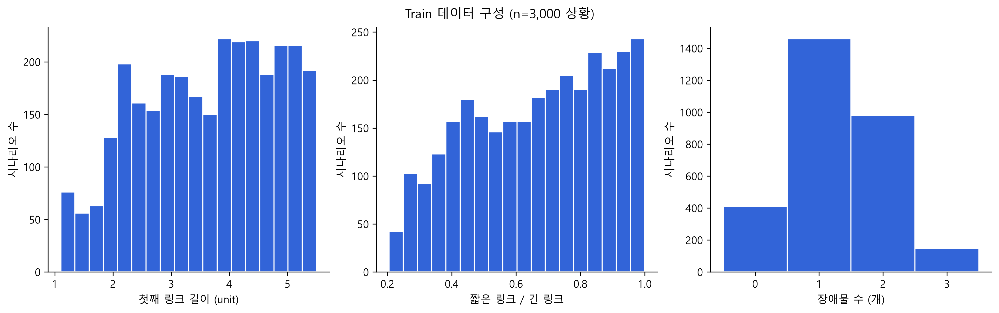

### 02_validity

후보 분모: 직선 6,000, 나머지 각 24,000. 조건부 무충돌 분모는 validity.csv의 reachable. 미확정은 성공으로 세지 않으며 별도 열에 기록했다. 같은 종류는 모든 그림에서 같은 색이다.

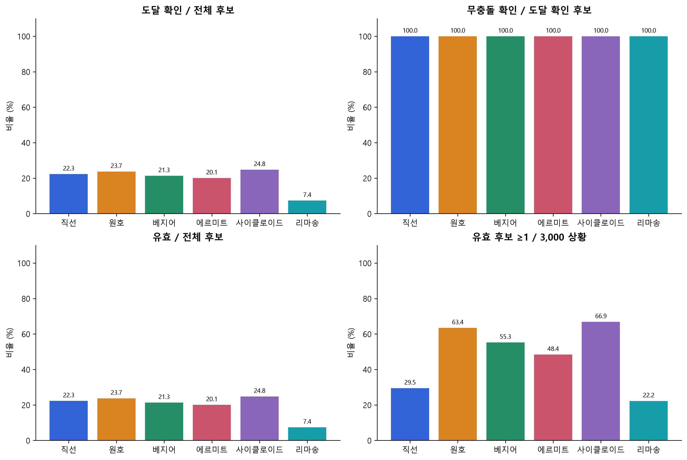

### 03_winners

주 비교 집합. 결정적 선택과 동점 후보별 1/k 배분을 분리했다. 직선은 2개, 나머지는 각 8개 후보라 탐색 기회가 다르다. 무장애물 O=0 동점은 안전성 우월이 아니다. 수치 허용오차 이내의 순위 안정까지 보증하지 않는다.

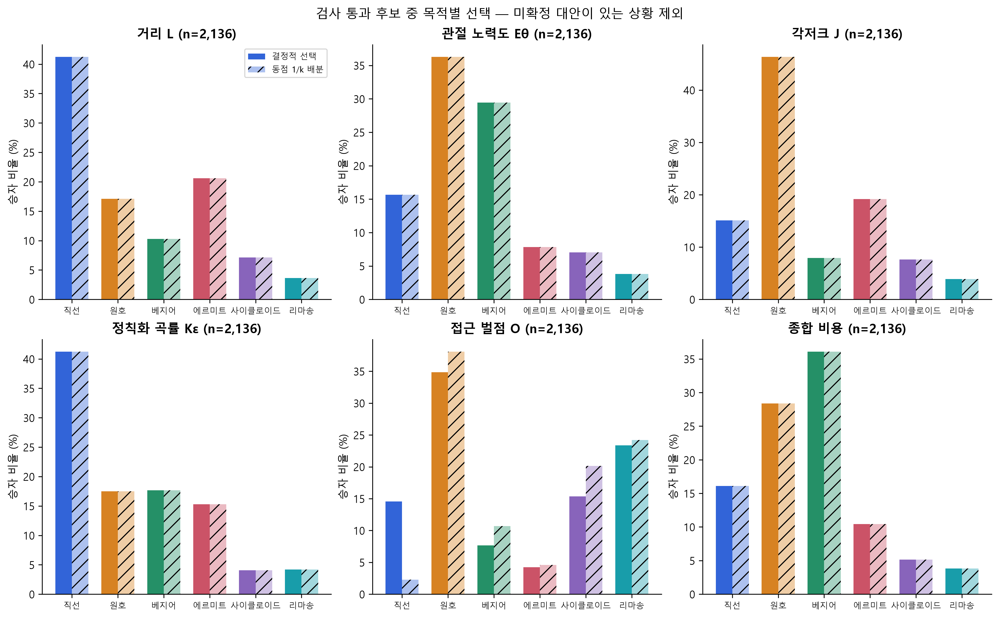

### 04_obstacle_winners

주 비교 집합 중 장애물 있음. 결정적 선택과 동점 후보별 1/k 배분을 분리했다. 직선은 2개, 나머지는 각 8개 후보라 탐색 기회가 다르다. 무장애물 O=0 동점은 안전성 우월이 아니다. 수치 허용오차 이내의 순위 안정까지 보증하지 않는다.

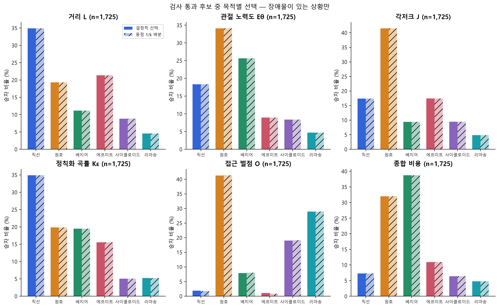

### 05_relationships

목적값과 독립적인 고정 SHA256 순서로 상황당 후보 하나를 선택했다. 세로축과 저크 가로축은 symlog, 선형 경계 0.01. 원 지표이며 인과효과가 아니다. 여유는 표본 최솟값이지 연속 최소의 정확한 참값이 아니다.

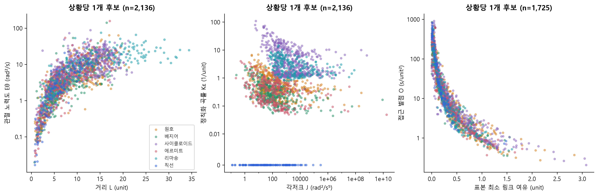

### 06_normalized_relationships

각 상황의 유효 후보 범위를 기준으로 한 정규화 관계다. 서로 다른 상황의 같은 정규화 값이 같은 원 비용을 뜻하지 않는다.

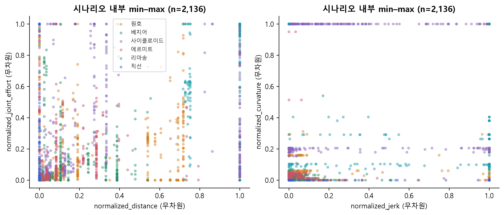

### 07_obstacle_conditions

배치별 전체 상황을 분모로 한 종류별 유효 후보 확보율. 막대 색과 달리 heatmap의 색은 비율을 뜻한다. n<30 표시는 CSV에 있다.

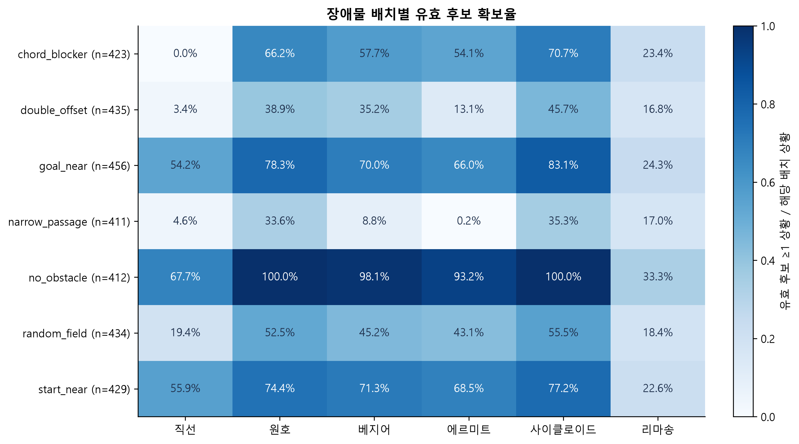

### 08_geometry_conditions

고정 구간은 왼쪽 포함·오른쪽 제외. 각 종류의 유효 후보 ≥1 상황 수 / 해당 구간 전체 상황 수다. 조건별 인과효과를 식별한 분석이 아니다.

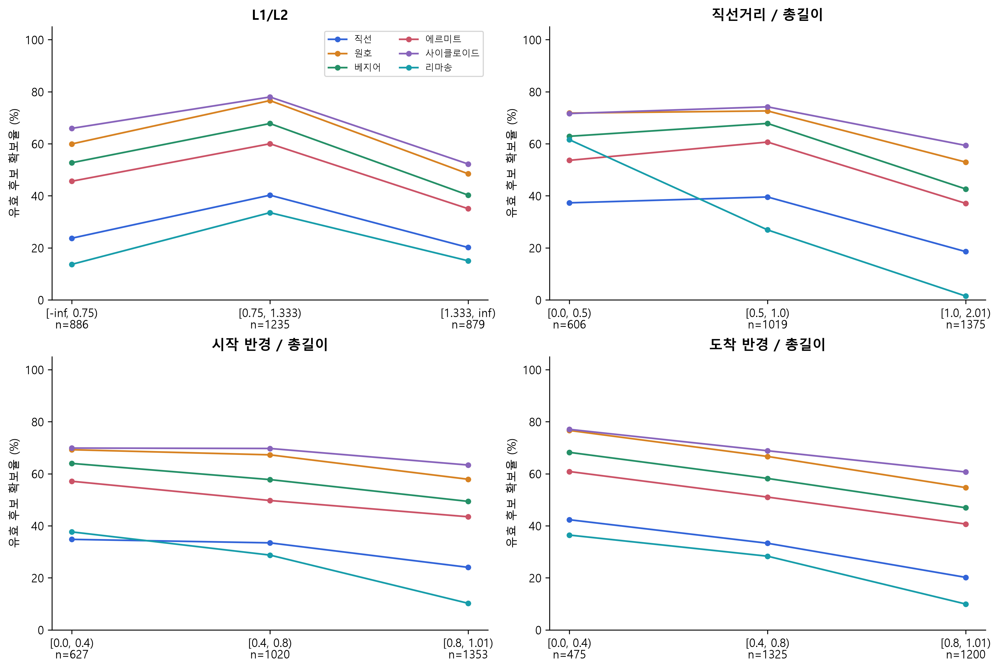

### case_family_line

주 비교 집합에서 종류별 고정 해시 선정. scenario_id=P4S004576, run_id=P4S004576_line_down. 식은 representative_equations.json. 빈 관절각은 계산되지 않은 값이다. invalid 사례에 시간 표본이 정상처럼 보여도 적응형 witness로 제외될 수 있다.

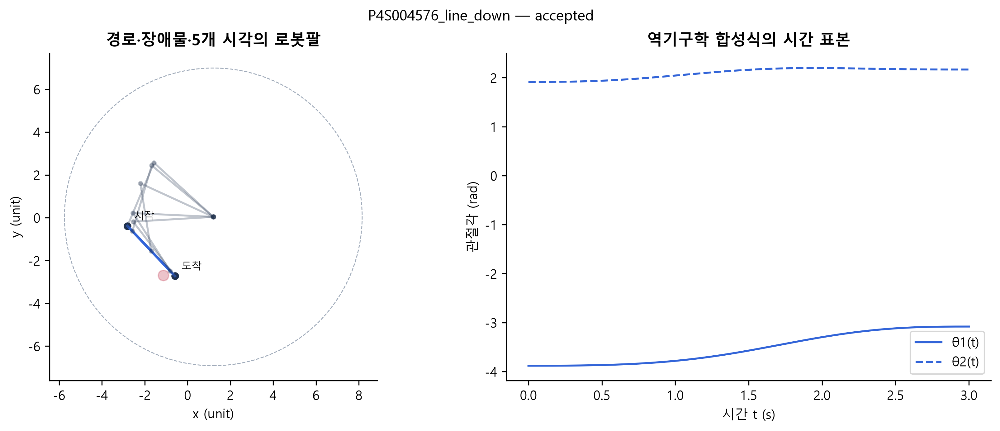

### integrands_family_line

P4S004576_line_down. Eθ/A/J는 저장된 적응형 노드에서 그렸으며 적분값은 가중합이다. L/Kε/O는 161점 적분을 재현했다. 피적분함수의 세로축 단위가 다르므로 높이를 직접 비교하지 않는다.

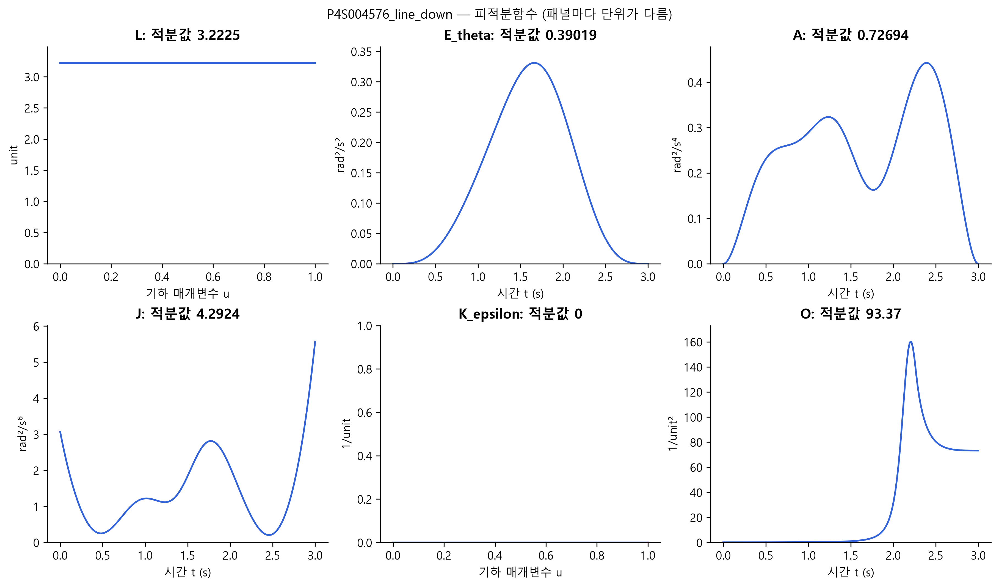

### case_family_arc

주 비교 집합에서 종류별 고정 해시 선정. scenario_id=P4S002885, run_id=P4S002885_arc_p40_up. 식은 representative_equations.json. 빈 관절각은 계산되지 않은 값이다. invalid 사례에 시간 표본이 정상처럼 보여도 적응형 witness로 제외될 수 있다.

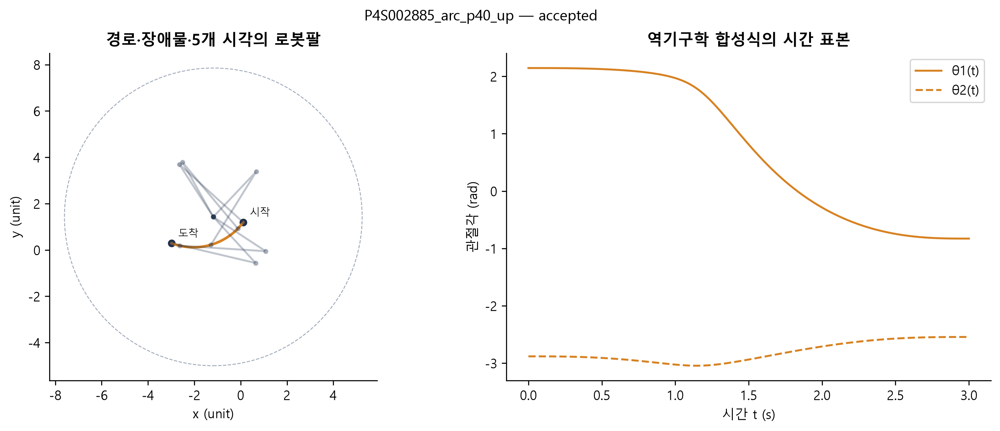

### integrands_family_arc

P4S002885_arc_p40_up. Eθ/A/J는 저장된 적응형 노드에서 그렸으며 적분값은 가중합이다. L/Kε/O는 161점 적분을 재현했다. 피적분함수의 세로축 단위가 다르므로 높이를 직접 비교하지 않는다.

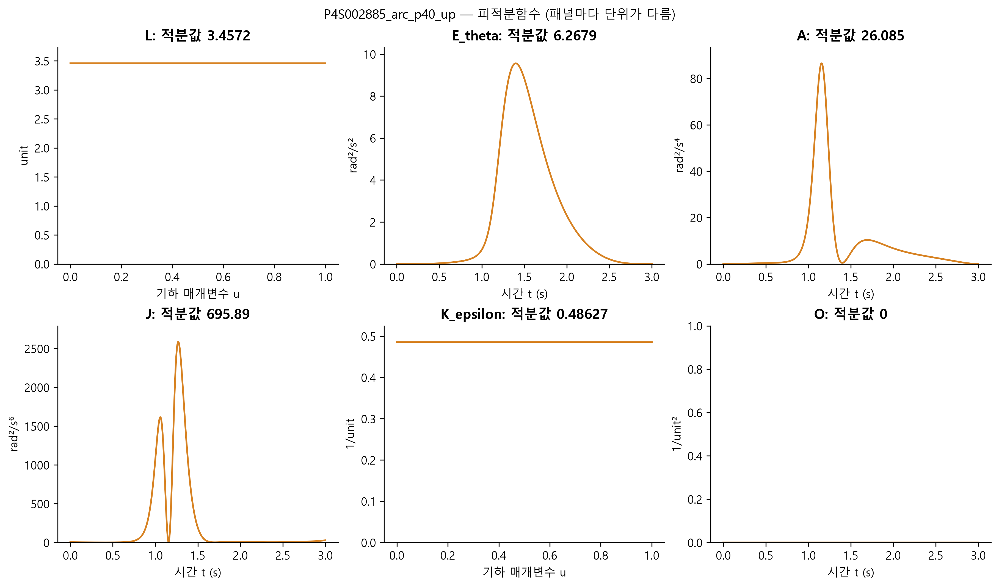

### case_family_bezier

주 비교 집합에서 종류별 고정 해시 선정. scenario_id=P4S000481, run_id=P4S000481_bezier_m40_up. 식은 representative_equations.json. 빈 관절각은 계산되지 않은 값이다. invalid 사례에 시간 표본이 정상처럼 보여도 적응형 witness로 제외될 수 있다.

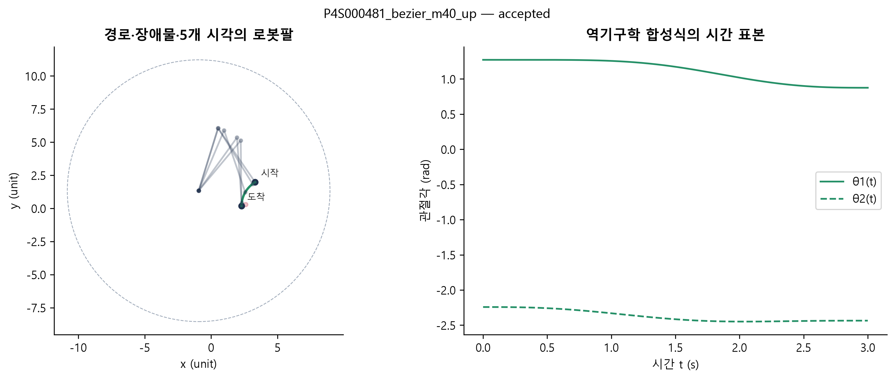

### integrands_family_bezier

P4S000481_bezier_m40_up. Eθ/A/J는 저장된 적응형 노드에서 그렸으며 적분값은 가중합이다. L/Kε/O는 161점 적분을 재현했다. 피적분함수의 세로축 단위가 다르므로 높이를 직접 비교하지 않는다.

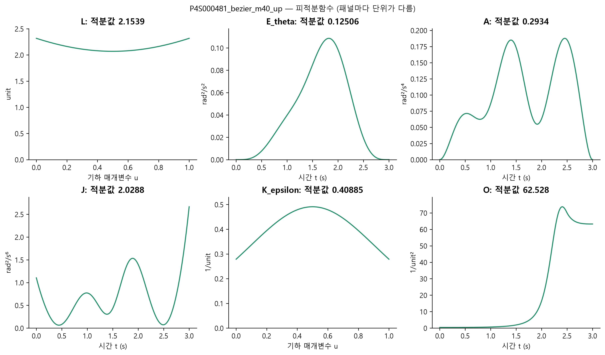

### case_family_hermite

주 비교 집합에서 종류별 고정 해시 선정. scenario_id=P4S004194, run_id=P4S004194_hermite_m80_up. 식은 representative_equations.json. 빈 관절각은 계산되지 않은 값이다. invalid 사례에 시간 표본이 정상처럼 보여도 적응형 witness로 제외될 수 있다.

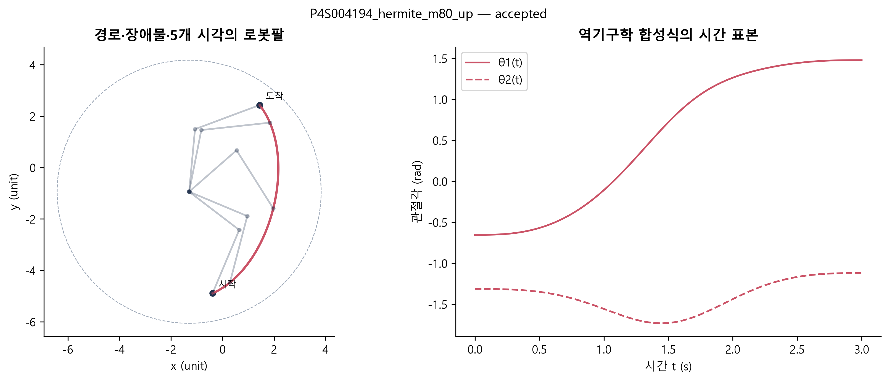

### integrands_family_hermite

P4S004194_hermite_m80_up. Eθ/A/J는 저장된 적응형 노드에서 그렸으며 적분값은 가중합이다. L/Kε/O는 161점 적분을 재현했다. 피적분함수의 세로축 단위가 다르므로 높이를 직접 비교하지 않는다.

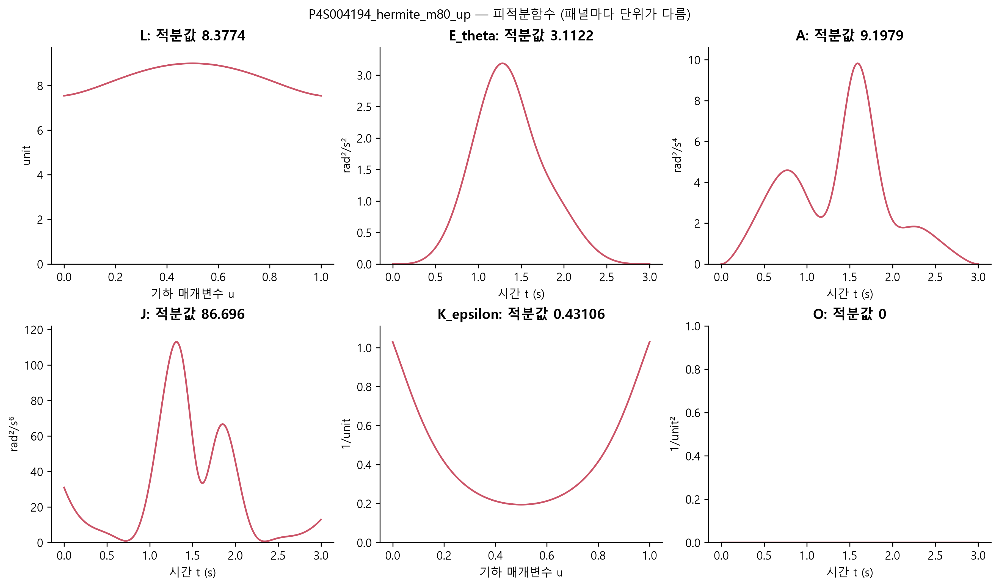

### case_family_cycloid

주 비교 집합에서 종류별 고정 해시 선정. scenario_id=P4S004784, run_id=P4S004784_cycloid_p80_down. 식은 representative_equations.json. 빈 관절각은 계산되지 않은 값이다. invalid 사례에 시간 표본이 정상처럼 보여도 적응형 witness로 제외될 수 있다.

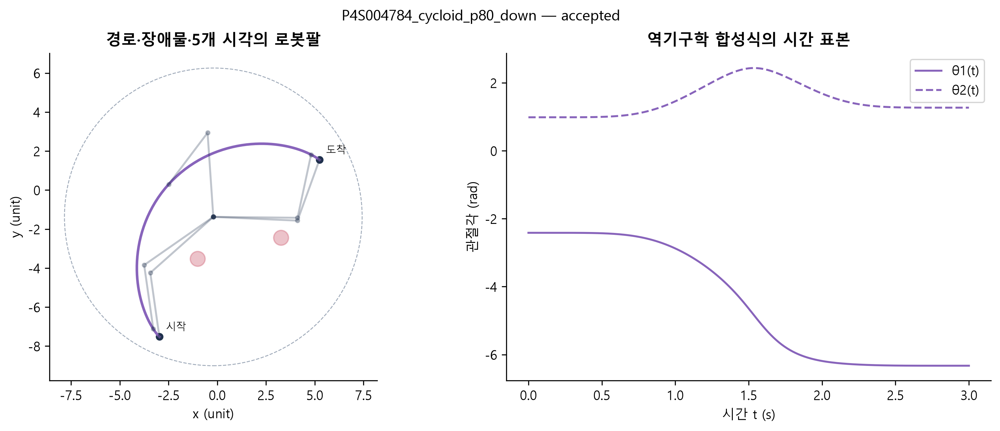

### integrands_family_cycloid

P4S004784_cycloid_p80_down. Eθ/A/J는 저장된 적응형 노드에서 그렸으며 적분값은 가중합이다. L/Kε/O는 161점 적분을 재현했다. 피적분함수의 세로축 단위가 다르므로 높이를 직접 비교하지 않는다.

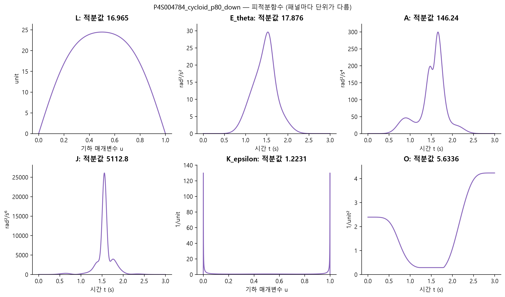

### case_family_limacon

주 비교 집합에서 종류별 고정 해시 선정. scenario_id=P4S000037, run_id=P4S000037_limacon_p40_up. 식은 representative_equations.json. 빈 관절각은 계산되지 않은 값이다. invalid 사례에 시간 표본이 정상처럼 보여도 적응형 witness로 제외될 수 있다.

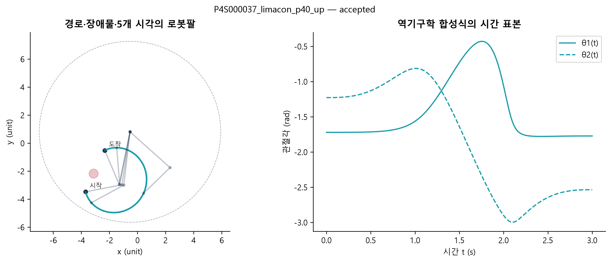

### integrands_family_limacon

P4S000037_limacon_p40_up. Eθ/A/J는 저장된 적응형 노드에서 그렸으며 적분값은 가중합이다. L/Kε/O는 161점 적분을 재현했다. 피적분함수의 세로축 단위가 다르므로 높이를 직접 비교하지 않는다.

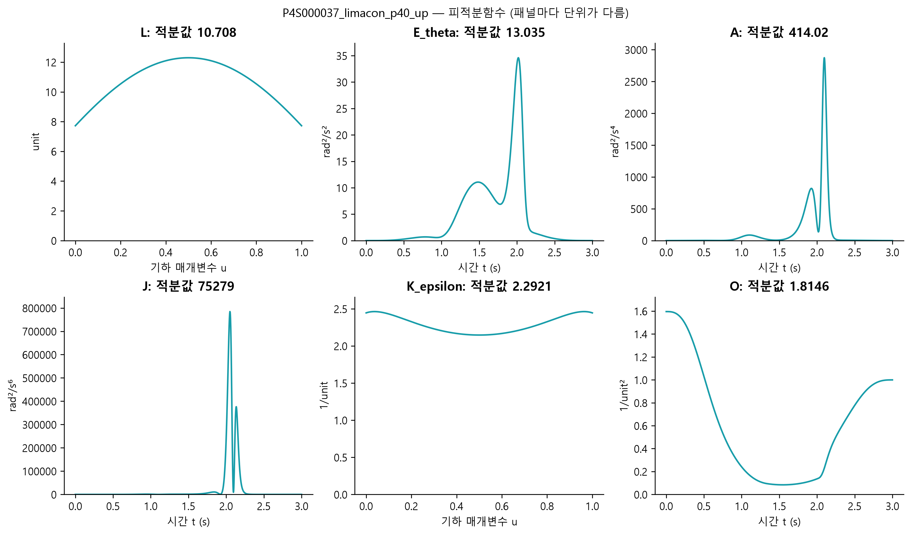

### case_unreachable

적응형 경로 검사 위반 witness가 있는 고정 해시 사례. scenario_id=P4S002425, run_id=P4S002425_arc_m80_down. 식은 representative_equations.json. 빈 관절각은 계산되지 않은 값이다. invalid 사례에 시간 표본이 정상처럼 보여도 적응형 witness로 제외될 수 있다.

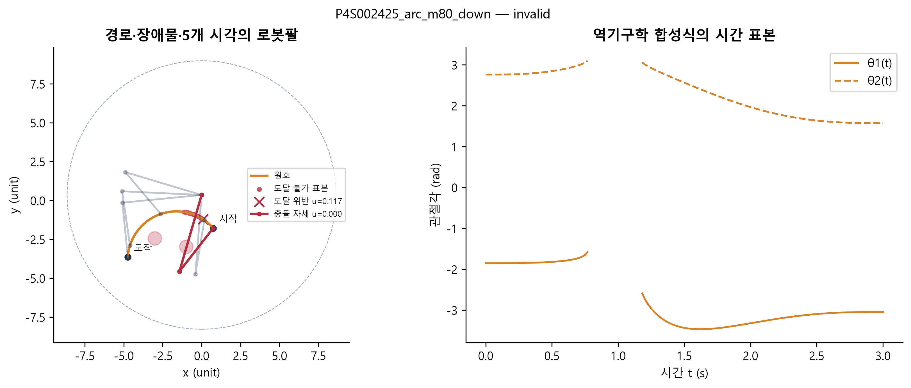

### case_collision

적응형 경로 검사 위반 witness가 있는 고정 해시 사례. scenario_id=P4S002488, run_id=P4S002488_arc_p40_up. 식은 representative_equations.json. 빈 관절각은 계산되지 않은 값이다. invalid 사례에 시간 표본이 정상처럼 보여도 적응형 witness로 제외될 수 있다.

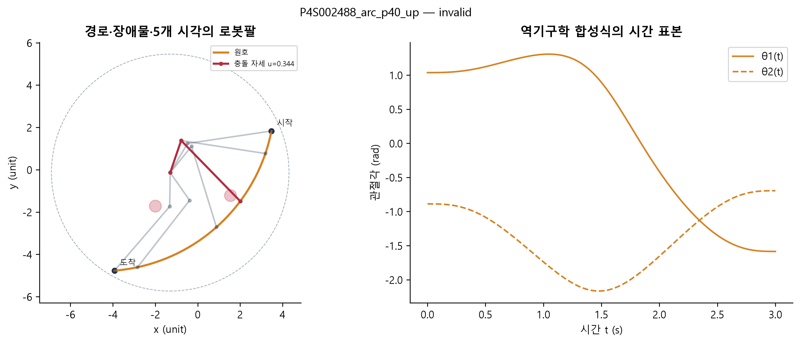

### 09_objective_tradeoff

P4S000239. 두 목적의 동점 집합이 겹치지 않고 경로 형태도 다른 실제 사례를 고정 해시로 선택했다. 42개 후보와 계산 오차 범위에 한정된 관찰이며 모든 상황의 차이를 대표하지 않는다.

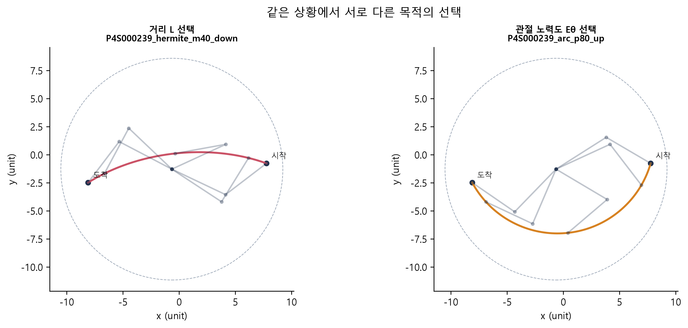

### 10_sampled_grid_diagnostics

적응형 검사의 조기 종료 영향을 설명하기 위한 보조 표본 진단. 두 격자 모두 도달 가능한 후보만 조건부 무충돌 분모에 넣었다. 후보 분모는 직선 6,000개, 나머지 각 24,000개이며 조건부 분모는 sampled_grid_diagnostics.csv에 있다. 표본 사이 충돌을 놓칠 수 있어 이 값으로 최종 승자를 고르지 않는다.

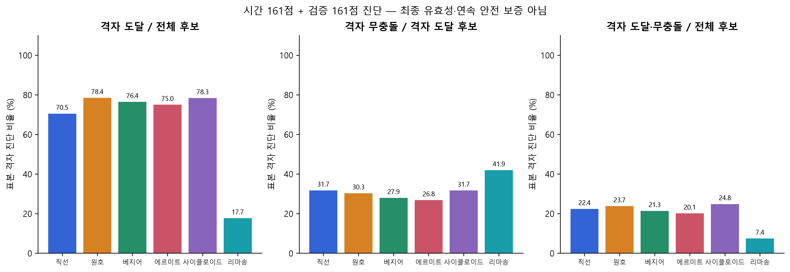